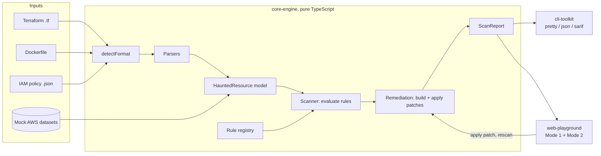

# Design Document

## Overview

PhantomGuard turns configuration text or a pre-loaded mock AWS account into a list of security Findings and, for each one that has a safe deterministic fix, an ExorcismPatch. Everything runs on the user's machine. The product is one analysis engine behind three front doors: a library, a CLI and a web playground.

Key decisions:

| Decision | Choice | Reason |
| --- | --- | --- |
| Where analysis runs | Entirely client-side (browser or local Node) | Users paste sensitive infrastructure code. No upload means no trust question. Requirements 12 and 16. |
| Engine shape | Pure functional core: `parse -> normalize -> evaluate -> remediate` | A scan is a function of its input, which makes property-based testing direct. Requirement 9.6. |
| Rule input | One normalized `HauntedResource` model | One rule serves Terraform, Dockerfile, IAM and datasets. Requirement 3.3. |
| Playground stack | Vite + React + TypeScript + Tailwind CSS v4, static output | Static files deploy to Netlify with no runtime. Next.js is allowed only as `output: 'export'`; see `tech.md`. |
| Engine dependencies | None at runtime | Small browser bundle, no supply-chain surface in the part that reads untrusted text. |
| Package manager | npm workspaces (`packages/*`); Yarn also resolves them | `npm` ships with Node, so Netlify needs no setup. |

Non-goals: live AWS API access, credential handling, network scanning, auto-writing to a user's cloud account, and any server component.

## Architecture

### Workspace layout

```text
/
├── .kiro/                         governance: specs, steering, hooks, settings
├── packages/
│   ├── core-engine/               @phantomguard/core-engine (library)
│   │   └── src/
│   │       ├── contracts/         HauntedResource, DetectionRule, ExorcismPatch, Finding, ScanReport
│   │       ├── parsers/           format detection + one parser per format
│   │       ├── rules/             rulesets: iam/, network/, storage/, container/
│   │       ├── remediation/       patch construction, application, least-privilege catalog
│   │       ├── scanner/           registry, orchestration, scoring
│   │       ├── datasets/          mock AWS accounts for Mode 1
│   │       └── util/              frozen copies, JSON pointer, line diff, redaction
│   ├── cli-toolkit/               @phantomguard/cli-toolkit (the `phantomguard` command)
│   └── web-playground/            @phantomguard/web-playground (Vite SPA)
├── scripts/                       governance + secrets audits (Node built-ins only)
├── netlify.toml                   zero-config deploy
└── package.json                   npm workspaces root
```

Dependency direction is strictly one-way: `web-playground -> core-engine` and `cli-toolkit -> core-engine`. `core-engine` imports nothing from the other packages and no DOM or Node API.

### System context



### Dual-mode client-side architecture

Both modes feed the same `scan()` function. They differ only in where the `HauntedResource[]` comes from and in what the user does with the result.

```mermaid
sequenceDiagram
    autonumber
    participant U as User
    participant UI as Playground (main thread)
    participant W as Scan Worker
    participant E as core-engine

    rect rgb(15, 23, 42)
    Note over U,E: Mode 1, Haunted Cloud Inspector
    U->>UI: open app / choose dataset
    UI->>W: scanDataset(datasetId)
    W->>E: loadDataset(id) then scan(resources)
    E-->>W: ScanReport
    W-->>UI: ScanReport
    U->>UI: Exorcise (finding f)
    UI->>W: applyPatch(resources, f.patch) then rescan
    W->>E: applyPatch + scan
    E-->>UI: new resources + ScanReport
    end

    rect rgb(15, 23, 42)
    Note over U,E: Mode 2, Custom Config Scanner
    U->>UI: paste / drop text, choose format
    UI->>W: scanText(text, format)
    W->>E: parseConfig(text, format) then scan(resources)
    E-->>W: ParseResult + ScanReport
    W-->>UI: ScanReport with Diagnostics
    end
```



| | Mode 1: Haunted Cloud Inspector | Mode 2: Custom Config Scanner |
| --- | --- | --- |
| Source of resources | `loadDataset(id)`: frozen, fictional AWS account | `parseConfig(text, format)` |
| Input from user | Dataset choice, patch actions | Text or file, optional format override |
| Patch effect | Applied in memory to attributes, then rescan | Shown as diff and copied, never written |
| Primary outputs | Resource cards, Haunting level meter (the Risk_Score) | Findings with source lines, Diagnostics |
| Requirements | 13, 17 | 1, 2, 18 |

State is held in React state and `sessionStorage` only (Requirement 16.2). The Playground makes no request after first load (Requirement 16.4).

### Scan pipeline

1. **Guard**: reject input over 1 MiB (`PG-LIMIT-INPUT-SIZE`).
2. **Detect**: the registered parsers each return a confidence score for the text. The highest score above 0 wins (`PG-PARSE-UNKNOWN-FORMAT` otherwise). Terraform is recognized from the block headers it starts with.
3. **Parse**: the chosen parser returns `{ resources, diagnostics }` and never throws.
4. **Normalize**: parsers emit `HauntedResource` directly. Datasets already are.
5. **Evaluate**: for each resource and each enabled rule whose `appliesTo` includes the resource kind, call `rule.evaluate(frozenResource)` (and `rule.diagnose` when present). A throwing rule becomes a `PG-RULE-ERROR` Diagnostic. A resource whose id was already seen is skipped with `PG-RESOURCE-DUPLICATE-ID`.
6. **Remediate**: for each violation, `rule.remediate` may return a patch. Patches are built with `buildPatch`, which fills the preview and unified diff.
7. **Assemble**: dedupe, sort, count, score (`ScanReport`).

## Components and interfaces

### Package: `core-engine`

| Module | Responsibility | Public entry |
| --- | --- | --- |
| `contracts/` | Types only. No runtime code except `SEVERITY_ORDER` and `SEVERITY_WEIGHT`. | `HauntedResource`, `DetectionRule`, `ExorcismPatch`, `Finding`, `ScanReport` |
| `parsers/` | `detectFormat`, `parseConfig`, one `ConfigParser` per format. Terraform is two layers: `hcl.ts` (tokenizer and tolerant parser to blocks, attributes and values) and `terraform.ts` (maps blocks to HauntedResources) | `parseConfig(text, options)` |
| `rules/` | One file per rule, grouped into rulesets | `ALL_RULES`, `createRuleRegistry` |
| `remediation/` | `buildPatch`, `applyPatch`, IAM least-privilege helpers and catalog | `applyPatch`, `applyPatches` |
| `scanner/` | Orchestration and scoring | `scan(resources, options)`, `scanText(text, options)` |
| `datasets/` | Frozen mock accounts | `loadDataset(id)`, `listDatasets()` |

### Package: `cli-toolkit`

Commands `scan` and `exorcise`, built on `node:util.parseArgs` with no third-party dependency. All I/O goes through a `CliIo` object, so `main(argv, io)` can be driven by tests without a process. Output renderers: `pretty` (ANSI only on a TTY without `NO_COLOR`; an input that could not be analyzed is shown as "not analyzed", never as clean), `json` (one document wrapping each `ScanReport`, passed through `redactReport`), `sarif` (2.1.0). Exit codes: 0 clean, 1 findings at or above `--fail-on`, 2 usage error, unreadable input or an input with an error Diagnostic; 2 outranks 1 (Requirement 14). `exorcise` prints diffs and never writes; `--write` is a planned task.

### Package: `web-playground`

```text
src/
├── main.tsx                 entry
├── App.tsx                  shell: header, mode tabs, footer
├── index.css                Tailwind import, @theme tokens, keyframes
├── modes/
│   ├── HauntedCloudInspector.tsx
│   └── CustomConfigScanner.tsx
├── components/              ModeTabs, Dashboard, ResourceCard, ResourceDrawer (native <dialog>),
│                            FindingCard, SplitDiff, CopyButton, CvssMeter, SourceExcerpt,
│                            SeverityBadge, HauntingMeter
├── workers/                 scan.worker.ts (runs core-engine off the main thread), scan-protocol.ts
└── lib/                     scan-client.ts (worker client, 5 s limit, warm()), useScanClient.ts,
                             useSessionState.ts, lexicon.ts (spooky wording), severity-style.ts,
                             cvss.ts (CVSS v3.1 estimate), line-diff.ts (side-by-side alignment),
                             risk-copy.ts, styles.ts, samples.ts
```

CVSS scores are estimates. `cvss.ts` assigns a vector to each rule and Severity tier and applies the CVSS v3.1 base equations; the equations are checked against 18 published scores. The drawer uses the native modal `<dialog>`, which supplies the focus trap, the Escape key, an inert background and focus return.

The worker is imported with Vite's `?worker&inline`, so it ships inside the main bundle as a Blob. Starting a scan therefore makes no network request (Requirement 16.4); the CSP allows it through `worker-src blob:`. Pasted configuration lives in React state only and is never written to storage; only the chosen format and dataset are kept in `sessionStorage`.

## Data models

These contracts live in `packages/core-engine/src/contracts/` and are the source of truth. This section mirrors them. If the code and this document disagree, fix whichever is wrong in the same change.

### Shared primitives

```typescript
export type JsonPrimitive = string | number | boolean | null;
export type JsonValue = JsonPrimitive | readonly JsonValue[] | { readonly [key: string]: JsonValue };
export type JsonObject = { readonly [key: string]: JsonValue };

export type Severity = 'CRITICAL' | 'HIGH' | 'MEDIUM' | 'LOW' | 'INFO';
export const SEVERITY_ORDER: readonly Severity[] = ['CRITICAL', 'HIGH', 'MEDIUM', 'LOW', 'INFO'];
export const SEVERITY_WEIGHT: Readonly<Record<Severity, number>> = {
  CRITICAL: 40, HIGH: 20, MEDIUM: 8, LOW: 2, INFO: 0,
};

export type ConfigFormat = 'terraform' | 'dockerfile' | 'iam-policy';
```

### `HauntedResource`

```typescript
export type ResourceKind =
  | 'aws_iam_policy'
  | 'aws_iam_role'
  | 'aws_security_group'
  | 'aws_s3_bucket'
  | 'aws_ebs_volume'
  | 'aws_db_instance'
  | 'aws_ecs_task_definition'
  | 'container_image';

export type ResourceOrigin =
  | { readonly mode: 'haunted-cloud'; readonly datasetId: string }
  | {
      readonly mode: 'custom-config';
      readonly format: ConfigFormat;
      readonly startLine: number; // 1-based, inclusive
      readonly endLine: number;
    };

export interface HauntedResource {
  /** Unique within one scan, stable across scans of identical input. */
  readonly id: string;
  readonly kind: ResourceKind;
  readonly name: string;
  readonly provider: 'aws' | 'docker';
  readonly region?: string;
  readonly origin: ResourceOrigin;
  /** Normalized, JSON-serializable configuration. Rules read only this. */
  readonly attributes: JsonObject;
}
```

Normalized attribute paths that rules depend on (Requirement 3.3):

| Kind | Attribute path | Meaning |
| --- | --- | --- |
| `aws_iam_policy`, `aws_iam_role` | `document` | IAM policy document `{ Version, Statement[] }`. Parsers normalize `Statement` to an array so patches can address it by index. |
| `aws_iam_role` | `trustPolicy?` | The role's assume-role policy document (checked by `PG-IAM-002`) |
| `aws_iam_policy`, `aws_iam_role` | `observedUsage?.actions[]`, `observedUsage?.resources[]` | Evidence from access analysis, when available |
| `aws_iam_policy` (from text) | `statementLines?[]` | 1-based start line of each statement, when the parser could locate them |
| `aws_security_group` | `ingress[]` | `{ protocol, fromPort, toPort, cidrBlocks[], ipv6CidrBlocks[], securityGroups?[], prefixListIds?[], self?, description?, line? }`. `protocol` is `tcp`, `udp`, `icmp` or `-1`. |
| `aws_s3_bucket` | `acl?`, `publicAccessBlock?`, `policy?` | Canned ACL, `{ blockPublicAcls, blockPublicPolicy, ignorePublicAcls, restrictPublicBuckets }`, and the bucket policy document (checked by `PG-STO-002`) |
| `aws_s3_bucket` | `serverSideEncryption?` | `{ algorithm: 'AES256' \| 'aws:kms' \| 'aws:kms:dsse', kmsKeyId?, bucketKeyEnabled? }` |
| `aws_ebs_volume` | `encrypted` | boolean |
| `aws_db_instance` | `storageEncrypted` | boolean |
| `aws_ecs_task_definition` | `containers[]` | `{ name, image, user?, privileged? }` |
| `container_image` | `finalStage` | `{ baseImage, name?, fromLine, user?, userLine?, userUnresolved? }` for the final build stage. An absent `user` means root. `userUnresolved` is true when `USER` uses a variable. |

### `DetectionRule`

```typescript
export interface ComplianceReference {
  readonly benchmark: string; // 'CIS AWS Foundations Benchmark'
  readonly version: string; //   'v3.0.0'
  readonly control: string; //   '1.16'
  readonly title: string;
}

export type RuleCategory = 'IAM' | 'NET' | 'STO' | 'CTR';

export interface RuleViolation {
  readonly severity: Severity;
  readonly message: string;
  /** Stable key within one resource, used for deduplication, e.g. 'statement:2'. */
  readonly locationKey: string;
  /** Machine-readable evidence the patch builder and the UI can use. */
  readonly evidence: JsonObject;
  /** 1-based line in the source text, when the rule can pin one down. */
  readonly line?: number;
  /** Overrides the rule-level references when only some apply to this case. */
  readonly references?: readonly ComplianceReference[];
}

export interface DetectionRule {
  /** `PG-<CATEGORY>-<NNN>`, unique in a registry. */
  readonly id: string;
  readonly category: RuleCategory;
  readonly title: string;
  /** Technical, factual description. */
  readonly description: string;
  /** Spooky title, Playground copy only. */
  readonly ward: string;
  /** Highest severity this rule can emit; used for SARIF rule metadata. */
  readonly defaultSeverity: Severity;
  readonly appliesTo: readonly ResourceKind[];
  readonly references: readonly ComplianceReference[];
  /** Pure. Must not mutate, perform I/O or read clocks or randomness. */
  evaluate(resource: HauntedResource): readonly RuleViolation[];
  /** Pure. Returns a patch, or guidance when no safe deterministic fix exists. */
  remediate(resource: HauntedResource, violation: RuleViolation): Remediation;
  /** Optional, pure. Informational Diagnostics that are not Findings. */
  diagnose?(resource: HauntedResource): readonly Diagnostic[];
}

export type Remediation =
  | { readonly kind: 'patch'; readonly patch: ExorcismPatch }
  | { readonly kind: 'guidance'; readonly guidance: string };
```

### `ExorcismPatch`

```typescript
/**
 * One edit to `resource.attributes`; `path` is an RFC 6901 JSON Pointer. Semantics are "set":
 * the parent must exist, a missing object member is created, an array index must already exist.
 * A set writes an absolute value, so applying a patch twice equals applying it once.
 * (An array element is removed by setting its parent array to the shorter array.)
 */
export interface PatchOperation {
  readonly op: 'set';
  readonly path: string;
  readonly value: JsonValue;
}

/** What must hold at a pointer before a patch may be applied (the stale-patch guard). */
export type PatchPrecondition =
  | { readonly path: string; readonly exists: true; readonly equals: JsonValue }
  | { readonly path: string; readonly exists: false };

export interface PatchPreview {
  readonly before: string;
  readonly after: string;
  /** Unified diff of before and after. */
  readonly unifiedDiff: string;
}

export interface ExorcismPatch {
  /** `<ruleId>:<resourceId>:<locationKey>` */
  readonly id: string;
  readonly ruleId: string;
  readonly resourceId: string;
  readonly title: string;
  readonly rationale: string;
  /** True when the change can alter runtime behavior and needs a human decision. */
  readonly reviewRequired: boolean;
  readonly precondition: PatchPrecondition;
  readonly operations: readonly PatchOperation[];
  readonly preview: PatchPreview;
}
```

Patch application (`applyPatch`) is pure and returns a new frozen resource:

- A patch for a different resource id is rejected.
- If every operation is already in effect, the unchanged resource is returned, which makes application idempotent.
- Otherwise the precondition must hold, or the patch is rejected as stale. A patch is computed against the scanned state, so after applying one patch to a resource, scan again before applying another.
- A path that does not exist returns `{ ok: false, error }` and leaves the input untouched.

`redactReport(report)` returns a copy that is safe to print or serialize. Messages, previews and diffs are redacted when the report is built, but `ScanReport.resources` and patch preconditions keep raw values because `applyPatch` compares against them. Every output path (CLI JSON and SARIF, clipboard export, logs) must call `redactReport` first.

### `Finding` and `ScanReport`

```typescript
export interface Finding {
  readonly ruleId: string;
  readonly severity: Severity;
  readonly resourceId: string;
  readonly resourceName: string;
  readonly message: string;
  readonly locationKey: string;
  readonly line?: number;
  readonly references: readonly ComplianceReference[];
  readonly evidence: JsonObject;
  readonly patch?: ExorcismPatch;
  readonly guidance?: string;
}

export interface Diagnostic {
  readonly code: string; // 'PG-PARSE-SYNTAX', 'PG-RULE-ERROR', ...
  readonly level: 'error' | 'warning' | 'info';
  readonly message: string;
  readonly line?: number;
  readonly column?: number;
}

export interface ScanReport {
  readonly format?: ConfigFormat;
  readonly resources: readonly HauntedResource[];
  readonly findings: readonly Finding[];
  readonly diagnostics: readonly Diagnostic[];
  readonly summary: {
    readonly total: number;
    readonly bySeverity: Readonly<Record<Severity, number>>;
    readonly riskScore: number; // 0..100; the Playground labels it "Haunting level"
  };
}
```

### Least_Privilege_Format

Applies to every IAM patch (Requirement 10). Given a statement with a wildcard:

1. `Action` becomes an explicit array, sorted ascending, de-duplicated, with no `*`.
2. `Sid`, `Effect`, `Condition` and `Principal` keep their original values.
3. `Resource` is replaced only when evidence supplies narrower ARNs. It is never widened.
4. Evidence precedence: `observedUsage` on the resource, then the read-only catalog, then no patch and guidance only.
5. `reviewRequired` is `true`.
6. The `rationale` states which source supplied the actions (`observed usage` or `read-only catalog`).

Example, catalog source:

```diff
 {
   "Sid": "BucketAccess",
   "Effect": "Allow",
-  "Action": "s3:*",
+  "Action": ["s3:GetObject", "s3:GetObjectVersion", "s3:ListBucket"],
   "Resource": "arn:aws:s3:::crypt-backups/*"
 }
```

## Tailwind UI styling rules

Tailwind CSS v4, CSS-first configuration in `src/index.css`. The full contract is in `.kiro/steering/product.md`; the rules that code must follow:

| Concern | Rule |
| --- | --- |
| Page background | `bg-slate-950` on `body`. Panels use `bg-slate-900` with a `border-slate-800` border. |
| Vulnerability | Neon red token `--color-neon-red: #ff2d55`. Text `text-neon-red`, glow `shadow-neon-red`. Used for Findings, CRITICAL and HIGH, haunted resources. |
| Safe state | Neon green token `--color-neon-green: #39ff88`. Text `text-neon-green`, glow `shadow-neon-green`. Used for clean resources, applied patches, Haunting level 0. |
| Mid severities | MEDIUM `text-amber-300`, LOW `text-sky-300`, INFO `text-slate-400`. |
| Body text | `text-slate-200` on dark surfaces. Never place `text-slate-500` or darker on `bg-slate-950`. |
| Code and diffs | `font-mono`. Removed lines tinted red (`bg-neon-red/10`), added lines tinted green (`bg-neon-green/10`). |
| Motion | Flicker, pulse and fog are classes behind `motion-safe:`. A `prefers-reduced-motion` block disables the rest. |
| Fonts | System font stacks only (CSP `font-src 'self'`). A self-hosted display font is an optional task. |
| Color is not the only signal | Every severity color is paired with an icon and a text label (Requirement 19.6). |

## Error handling

| Situation | Behavior | Code |
| --- | --- | --- |
| Input over 1 MiB | Reject before parsing | `PG-LIMIT-INPUT-SIZE` |
| Unknown format | Empty report plus error | `PG-PARSE-UNKNOWN-FORMAT` |
| Format has no parser | Empty report plus error | `PG-PARSE-UNSUPPORTED` |
| Syntax error | Warning with line and column, parsing continues | `PG-PARSE-SYNTAX` |
| JSON nesting over 64 | Error, document skipped | `PG-PARSE-DEPTH` |
| More than 5,000 resources | Scan the first 5,000, add warning | `PG-LIMIT-RESOURCES` |
| Two resources share an id | Scan the first, skip the rest, add warning | `PG-RESOURCE-DUPLICATE-ID` |
| Terraform value cannot be resolved | Keep the resource, store the source text, info | `PG-PARSE-OPAQUE` |
| Terraform text has no supported resource | Info, so an empty result is not read as clean | `PG-PARSE-NO-RESOURCES` |
| Terraform companion points at an unknown bucket | Info, settings not applied | `PG-PARSE-ORPHAN` |
| `data "aws_iam_policy_document"` block | Info, not analyzed yet | `PG-PARSE-UNSUPPORTED-BLOCK` |
| Rule throws | Record error, continue | `PG-RULE-ERROR` |
| Unresolved container user | No finding, info | `PG-CTR-UNRESOLVED-USER` |
| Patch path missing | `applyPatch` returns `{ ok: false, error }`, input unchanged | n/a |

The engine never throws for user input. It throws only for programmer errors, such as registering a duplicate rule id.

## Correctness properties

Each property is a universal statement that fast-check verifies with at least 200 runs. Arbitraries live in `packages/core-engine/test/arbitraries/`. Every property test carries a comment `Feature: phantom-guard, Property N: <name>` and `Validates: Requirements X.Y`.

### Property 1: Parsers are total and deterministic

_For any_ string, `parseConfig(text)` returns without throwing, and a second call returns a deeply equal result.

**Validates: Requirements 2.2, 2.4**

### Property 2: Wildcard Allow statements are always found

_For any_ IAM policy that contains an Allow statement whose action list includes `*`, a scan reports a CRITICAL `PG-IAM-001` Finding for that statement.

**Validates: Requirements 5.1**

### Property 3: Deny statements and fully scoped statements are never flagged

_For any_ IAM policy whose statements are all Deny, or all Allow with explicit non-wildcard actions, a scan reports no `PG-IAM-001` Finding.

**Validates: Requirements 5.6**

### Property 4: One finding per statement at the highest severity

_For any_ IAM policy, the number of `PG-IAM-001` Findings per statement is at most one, its Severity equals the maximum of the Severities that the statement's individual actions would receive (global wildcard CRITICAL, service wildcard HIGH on a bare `*` Resource and MEDIUM on scoped Resources, partial wildcard LOW, `NotAction` HIGH), and its evidence lists every offending action, sorted.

**Validates: Requirements 5.2, 5.3, 5.4, 5.5, 5.7**

### Property 5: Public non-web ingress is always found

_For any_ security group with an ingress rule whose source is `0.0.0.0/0` or `::/0` and whose port range or protocol exposes anything beyond TCP 80 and 443, a scan reports a `PG-NET-001` Finding at the Severity the port category dictates.

**Validates: Requirements 6.1, 6.2, 6.3, 6.6**

### Property 6: Narrow sources and public web ports are never flagged

_For any_ security group whose ingress rules all use sources narrower than `/0`, or are public TCP 80 or 443 only, a scan reports no `PG-NET-001` Finding.

**Validates: Requirements 6.4, 6.5**

### Property 7: Encryption flags decide storage findings

_For any_ EBS volume, RDS instance or S3 bucket, a `PG-STO-001` Finding exists if and only if the resource lacks the encryption setting that Requirement 7 names.

**Validates: Requirements 7.1, 7.2, 7.3, 7.4**

### Property 8: Final-stage user decides container findings

_For any_ Dockerfile with one or more stages, a `PG-CTR-001` Finding exists if and only if the last `USER` instruction of the final stage is missing, `root` or `0`.

**Validates: Requirements 8.1, 8.2, 8.5**

### Property 9: Scan output is deterministic and ordered

_For any_ resource list, two scans return deeply equal reports, and the Findings are sorted by Severity descending, then rule id, then resource id, then location key.

**Validates: Requirements 9.2, 9.6**

### Property 10: Summary arithmetic is consistent

_For any_ report, the sum of `bySeverity` equals `total` equals `findings.length`, and `riskScore` equals `min(100, sum of weights)`.

**Validates: Requirements 9.3, 9.4**

### Property 11: Patches fix the finding and nothing else

_For any_ resource and any Finding that carries a patch, applying the patch and scanning again yields no Finding with the same rule id and location on that resource, and no Finding that was absent before.

**Validates: Requirements 11.2, 11.3**

### Property 12: Patch application is pure and idempotent

_For any_ patch, `applyPatch` does not mutate its input, and applying the patch to its own result returns a result deeply equal to the first.

**Validates: Requirements 11.1, 11.4**

### Property 13: Patches never widen access

_For any_ IAM patch, the set of actions after the patch is a subset of the actions the original statement already granted or of the evidence list, contains no `*`, and the Resource set is not larger than before.

**Validates: Requirements 10.2, 10.3**

### Property 14: Secrets are redacted

_For any_ resource attribute whose name contains `password`, `secret`, `token` or `access_key`, the value never appears in any Finding message, preview or diff.

**Validates: Requirements 10.7**

### Property 15: A throwing rule does not break the scan

_For any_ registry that contains a rule that always throws, a scan still returns a report, includes a `PG-RULE-ERROR` Diagnostic, and returns the same Findings as a scan without that rule.

**Validates: Requirements 4.3, 4.4**

### Property 16: Prototype keys are inert

_For any_ JSON input that contains `__proto__`, `constructor` or `prototype` keys, parsing and scanning leave `Object.prototype` unchanged.

**Validates: Requirements 3.5**

### Property 17: IAM patches come from evidence, need review, and are never invented

_For any_ IAM Finding, a patch exists only when usage evidence or the read-only catalog can supply the actions. WHEN usage evidence matches the wildcard, the new Action list equals the sorted, de-duplicated matching evidence. Every IAM patch has `reviewRequired` set to `true`. A `NotAction` Finding never has a patch. A Finding without a patch always carries guidance.

**Validates: Requirements 10.4, 10.5, 10.6**

### Property 18: Public principals are rated by their Condition

_For any_ IAM policy or trust policy, an Allow statement whose Principal is `*` or `{"AWS": "*"}` yields a CRITICAL `PG-IAM-002` Finding when it has no Condition and a MEDIUM one when it has a Condition. Deny statements and named principals yield none. The Finding never carries a patch.

**Validates: Requirements 5.8, 5.9**

### Property 19: Public S3 exposure follows ACL, policy and Block Public Access

_For any_ S3 bucket, the `PG-STO-002` Findings are exactly these: one `acl` Finding when the canned ACL is `public-read`, `public-read-write` or `authenticated-read`; one Finding per Allow statement with a public Principal; and one `public-access-block` Finding when any of the four settings is not `true`. Severities follow Requirement 7, a `Deny` statement or a named principal is never public, and each patch clears its own Finding without making another worse.

**Validates: Requirements 7.6, 7.7, 7.8, 7.9, 7.10**

## Testing strategy

| Layer | Tool | What it proves |
| --- | --- | --- |
| Properties (above) | Vitest + fast-check | Rules, parsers, patches, scoring behave for all generated inputs |
| Examples | Vitest | Dataset expectations (Requirement 13), SARIF and CLI snapshots |
| Component | Vitest + Testing Library | Modes render, exorcism flips a card from red to green |
| End-to-end smoke | Playwright against `vite preview` | Both modes work in a real browser; no network after load |
| Static | `tsc` strict, ESLint, Prettier | Type and style hygiene (also run by the pre-commit hook) |
| Governance | `npm run audit:governance` | Files present, hooks valid, requirements traced to tasks |

Failures print the fast-check seed and the shrunk counterexample (Requirement 22.3). Rerun a failure with `FC_SEED=<seed> npm test`.

## Security considerations

- Parsers use `JSON.parse` and hand-written scanners with linear-time loops. No regular expression is applied to user text unless it is linear.
- Parsed objects are built with `Object.create(null)`-safe helpers or `Map`s, so `__proto__` is data.
- The Playground sends a CSP of `default-src 'self'` and never renders user text as HTML. React escapes text, and no `dangerouslySetInnerHTML` is allowed (ESLint rule).
- Patches are previews. Neither the Playground nor the library writes to a user's cloud account.
- Dataset content is fictional. It uses the account id `123456789012` and no credential-shaped strings.
